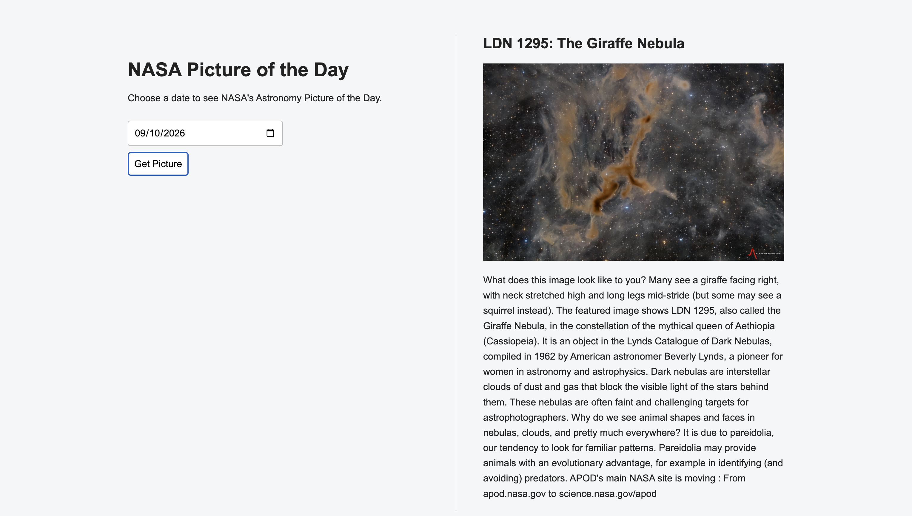

# NASA Astronomy Picture of the Day

A simple application that displays NASA's Astronomy Picture of the Day using HTML, CSS, and JavaScript.

## About

This application uses NASA's Astronomy Picture of the Day (APOD) API to retrieve and display NASA's featured astronomy image.

The application displays the image along with information about it, including its title, date, and explanation.

## Screenshot

## Built With

- HTML
- CSS
- JavaScript
- NASA Astronomy Picture of the Day API

## How It Works

1. The application sends a request to NASA's APOD API.
2. NASA returns information about the Astronomy Picture of the Day.
3. The application retrieves the image and its related information.
4. The results are dynamically displayed on the page.

## What I Practiced

- Fetching data from an API
- Working with JSON data
- Accessing properties from API responses
- DOM manipulation
- Dynamically displaying images and text
- Handling asynchronous API requests