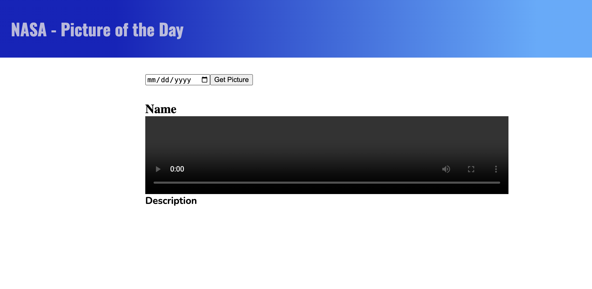

# Project: 🚀 Project: Simple NASA API

## Goal: Enable your user to enter a date and return the picture/video of the day from NASA's API

### Using the NASA Picture of the Day API, I added a date input so the API can show what the historical picture-of-the-day was. 

### Issues that came up:
### - Because some pictures are actually videos instead, I needed to create conditionals that ran depending on what the media type was. 
### - While styling, I ran out of tokens so it's good to think about alternative options for protecting token usage. A colleauge suggested creating a lcoal JSON file to fetch the data. 